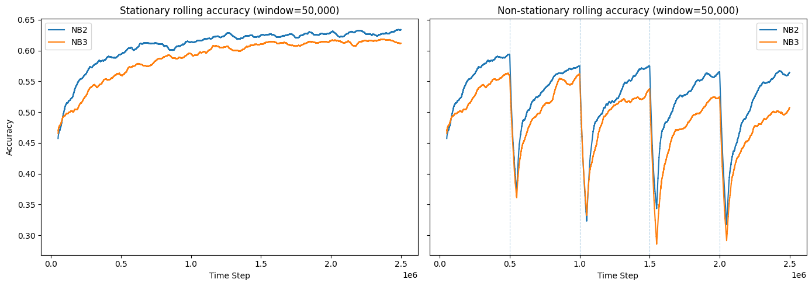
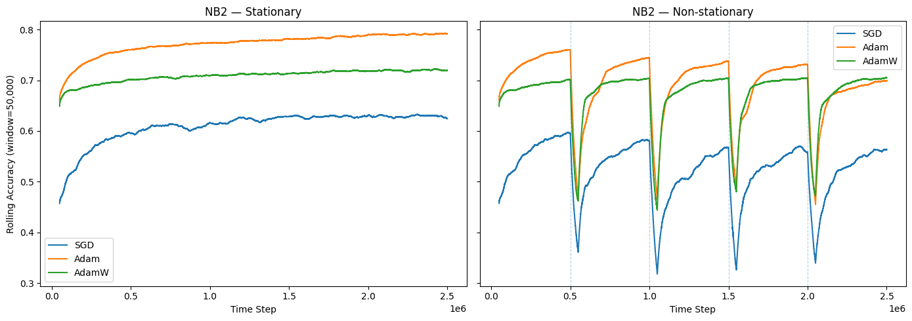
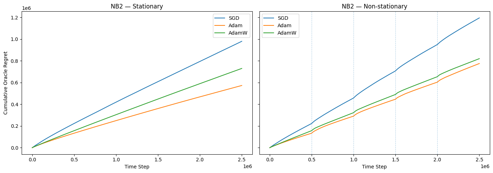
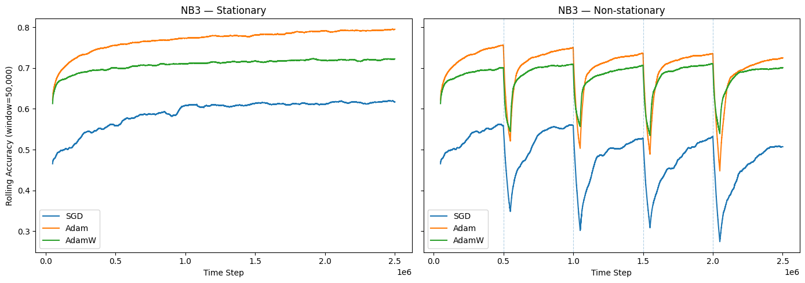

# Adaptive Optimization for Neural Contextual Bandit Committees

**Learning efficiency and robustness to concept drift**

This research project reproduces the NeuralBandit committee methods proposed by Allesiardo, Féraud, and Bouneffouf (2014) in [*A Neural Networks Committee for the Contextual Bandit Problem*](https://arxiv.org/abs/1409.8191) and extends them with adaptive neural-network optimization. We investigate whether Adam and AdamW improve online learning, cumulative reward, and recovery from concept drift relative to the original fixed-step SGD updates.

The implementation uses JAX to compile the sequential online-learning loop and batch the 10 independent repetitions and 15 candidate models on a GPU. NeuralBandit2 (NB2) is the primary method; NeuralBandit3 (NB3) is included as a secondary architectural ablation. Both notebooks are self-contained and retain their executed results.

## Repository structure

```text
.
├── README.md
├── requirements.txt
├── .gitignore
├── notebooks/
│   ├── 01_neural_bandit_reproduction.ipynb
│   └── 02_adamw_neural_bandit.ipynb
├── configs/
│   └── experiment_config.json
└── results/
    ├── figures/                # Original notebook plot outputs
    └── tables/                 # CSV exports of saved notebook results
```

| Notebook | Purpose |
|---|---|
| [01 — Reproduction](notebooks/01_neural_bandit_reproduction.ipynb) | Data preparation, original SGD neural-network updates, EXP3, NB2 and NB3; stationary and non-stationary experiments. |
| [02 — Adaptive optimization](notebooks/02_adamw_neural_bandit.ipynb) | SGD/Adam/AdamW implementations; primary NB2 and secondary NB3 ablations; accuracy, regret, recovery, runtime and learning-rate preference analysis. |

The notebooks are the executable experiment code. Configuration constants appear near the top of each notebook. [experiment_config.json](configs/experiment_config.json) is a human- and machine-readable snapshot of the settings, not an input read by the notebooks.

## Setup and execution

### Recommended: Google Colab with GPU

1. Download the repository or open either `.ipynb` file in Colab (File → Open notebook → GitHub or Upload).
2. Select **Runtime → Change runtime type → GPU**. A CUDA-capable GPU is strongly recommended for the full experiment.
3. Run the import cell and verify that JAX reports a GPU device. The executed notebooks report JAX `0.11.1` on CUDA; their output paths indicate Python 3.13. Other library versions were not recorded.
4. Run the notebook from top to bottom. Both notebooks automatically download and prepare the dataset; no separate preprocessing script is needed.

Notebook 01 runs four conditions. Notebook 02 runs twelve conditions (two architectures × three optimizers × two environments); keep `RUN_NB3_EXTENSION = True` to reproduce the complete ablation. Notebook 02 can also be run independently of Notebook 01. Its SGD results are fresh controls, not imported results from Notebook 01.

The published experiments are computationally intensive: each condition contains 10 runs of 2.5 million online rounds. Do not reduce these settings if reproducing the reported results. In the saved executions, Notebook 01 took about 7 minutes per condition, and Notebook 02 about 22–26 minutes per condition (roughly five hours in total for Notebook 02). Times depend on the accelerator and software environment, and include any compilation measured by the runner.

### Alternative: local Jupyter environment

Use a Python environment compatible with the recorded JAX version, preferably on a CUDA-equipped machine for full-scale runs. From the repository root:

```bash
python -m venv .venv
source .venv/bin/activate       # Linux/macOS; Windows: .venv\Scripts\activate
python -m pip install -r requirements.txt
jupyter lab
```

The requirements file specifies the direct dependencies and the recorded JAX version. It is not a fully pinned lockfile. The standard installation alone may provide only CPU support. For local GPU execution, follow the [official JAX installation instructions](https://docs.jax.dev/en/latest/installation.html) for the appropriate CUDA backend, JAX version, and platform. Full-scale local/GPU setup has not been independently tested. Colab is the environment used for the saved experiments.

### Outputs and resuming experiments

- Notebook 01 writes `.npz` condition files and `metadata.json` to `/content/neural_bandit_jax_results` in Colab (or a relative directory locally).
- Notebook 02 writes its results to `/content/adamw_neural_bandit_results` (or a relative directory locally). With `FORCE_RERUN = False`, completed condition files are reused when they exist. Set it to `True` or use a new results directory after changing experimental settings; the cache filenames do not encode every hyperparameter.
- To keep caches across Colab runtime resets, mount Google Drive and edit `RESULT_DIR` in the corresponding notebook before starting the experiments. Ensure the folder is persistent and writable.

The repository includes the saved notebook outputs, extracted PNG figures, and CSV summary tables. Full-resolution numerical `.npz` trajectories are generated by execution and are not included in this archive. If available, they can be distributed separately for analysis without retraining.

## Dataset and preprocessing

The project uses the [UCI Covertype dataset](https://archive.ics.uci.edu/dataset/31/covertype), obtained through `sklearn.datasets.fetch_covtype`. There are 581,012 observations, 54 raw features and seven forest-cover classes. The ten quantitative variables are discretized into five quantile bins each and one-hot encoded; the remaining 44 binary variables are retained. The resulting contextual representation contains 94 binary features.

The classification task is converted into a contextual-bandit simulation: the learner observes the context, selects one of seven actions and receives reward 1 for a correct choice or 0 otherwise. It receives no feedback for unplayed actions. Observations are shuffled once and streamed cyclically. Non-stationarity is simulated by rotating class labels every 500,000 rounds. No conventional held-out classification test split is used; the experiment measures online reward on the simulated stream, which loops over the dataset.

## Experimental configuration

| Parameter | Setting |
|---|---|
| Online rounds per run | 2,500,000 (inferred from the original paper's Figure 1) |
| Runs per condition | 10, with matched random starts and seeds |
| Data seed / experiment seed | 42 / 20261115 |
| Hidden layer sizes | 1, 5, 25, 50, 100 |
| Committee size | 15 models per optimizer |
| Action / model exploration | 0.005 / 0.1 |
| SGD learning rates | 0.01, 0.1, 1.0 |
| Adam and AdamW learning rates | 0.0001, 0.001, 0.01 |
| Adam-family parameters | β₁ = 0.9, β₂ = 0.999, ε = 10⁻⁸ |
| AdamW weight decay | 0.01 |
| Concept-drift interval | 500,000 rounds |
| Final accuracy window | 100,000 rounds |

All neural networks retain the one-hidden-layer sigmoid architecture and inverse-probability-weighted quadratic loss. NB2 uses one EXP3 selector for the committee; NB3 uses a separate selector per action. The reproduction uses the actual conditional action-sampling probability for all candidate-network updates and the observed global reward for each NB3 selector, documenting ambiguities in the original pseudocode. Adam and AdamW maintain first and second moments and an optimizer step count for each action network; only the played-action network in each candidate model is updated.

## Results

### Original paper reproduction

| Algorithm | Paper stationary final-100k accuracy | Reproduced stationary accuracy |
|---|---:|---:|
| NB2 | 76.00% | 63.23% |
| NB3 | 73.00% | 61.34% |



The reproduction captures online learning and recovery following simulated concept drift, although it does not match the original numerical accuracies or the original NB3 advantage in the non-stationary setting.

### Adaptive optimizer ablation

Final-100k accuracy (mean across 10 runs):

| Algorithm | Environment | SGD | Adam | AdamW |
|---|---|---:|---:|---:|
| NB2 | Stationary | 62.68% | **79.19%** | 72.05% |
| NB2 | Non-stationary | 56.25% | 69.84% | **70.42%** |
| NB3 | Stationary | 61.80% | **79.45%** | 72.25% |
| NB3 | Non-stationary | 50.75% | **72.34%** | 69.99% |





Both adaptive optimizers outperform the SGD controls in final-window accuracy and cumulative oracle regret in all four architecture/environment combinations. Adam achieves the lowest final cumulative regret in each combination; AdamW offers the fastest relative recovery after concept drift and lower observed across-run accuracy variability.

### Mean recovery time after concept drift

| Algorithm | SGD | Adam | AdamW |
|---|---:|---:|---:|
| NB2 | 161,974 | 121,076 | **55,120** |
| NB3 | 232,105 | 68,425 | **45,025** |

Recovery is the first post-drift 10,000-round rolling-accuracy window to reach at least 90% of that method's own mean accuracy over the 50,000 rounds preceding drift. The metric is calculated on the ten-run averaged reward trajectory and averaged across four drift events. It measures relative recovery, not time to a common absolute accuracy level.



### Result files

- [Baseline stationary summary](results/tables/baseline_stationary_summary.csv)
- [Optimizer performance (all 12 conditions)](results/tables/optimizer_performance.csv)
- [Improvement relative to SGD](results/tables/improvement_vs_sgd.csv)
- [Drift recovery summary](results/tables/drift_recovery.csv)
- [NB2 stationary learning-rate preferences](results/tables/nb2_learning_rate_preferences.csv)
- [Per-run final-window accuracy (rounded notebook logs)](results/tables/per_run_accuracy_rounded.csv)
- [All figures](results/figures/)

CSV exports retain the precision displayed in the executed notebooks; regret and per-run values may be rounded. See the notebooks for metric definitions and how to regenerate the full numerical arrays. Accuracy columns in CSVs are proportions, not percentages.

## Limitations and reproducibility notes

- The original paper omits its exact offline classifier, some implementation choices and exact random seeds. We distinguish exact oracle regret in this classification simulation from the 93%-rate reference approximation; the latter is not the original offline classifier's actual regret curve.
- The original comparison methods (Banditron, LinUCB and contextual Thompson sampling) are not implemented here. Our study evaluates the original neural committees and their optimizer variants.
- SGD and adaptive optimizers have different learning-rate grids but equal committee sizes; the improvements cannot be attributed exclusively to the optimizer update rule. Adam and AdamW share the same grid, permitting a more direct comparison of weight decay.
- The findings concern a single repeatedly streamed dataset with synthetic abrupt concept drift. Exact numerical reproduction across hardware and software versions is not guaranteed.
- Final EXP3 preferences remain concentrated on particular learning rates; the experiments do not establish learning-rate insensitivity.

## References

- Allesiardo, R., Féraud, R., and Bouneffouf, D. (2014). [A Neural Networks Committee for the Contextual Bandit Problem](https://arxiv.org/abs/1409.8191).
- Auer, P., Cesa-Bianchi, N., Freund, Y., and Schapire, R. E. (2002). The Nonstochastic Multiarmed Bandit Problem. *SIAM Journal on Computing*, 32(1), 48–77.
- Kingma, D. P., and Ba, J. (2015). [Adam: A Method for Stochastic Optimization](https://arxiv.org/abs/1412.6980). ICLR.
- Loshchilov, I., and Hutter, F. (2019). [Decoupled Weight Decay Regularization](https://arxiv.org/abs/1711.05101). ICLR.
- UCI Machine Learning Repository. [Covertype](https://archive.ics.uci.edu/dataset/31/covertype).
